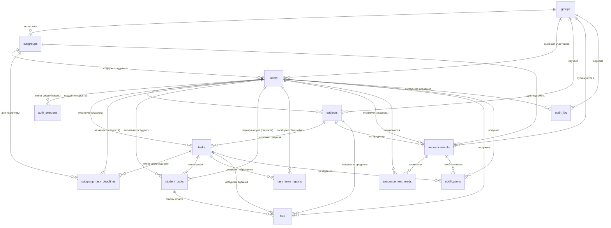

# Проектирование модели базы данных (PostgreSQL 15+)

В данной директории расположена единая модель базы данных для проекта **«Веб-приложение для учёта заданий и дедлайнов учебной группы»**, разработанная в полном соответствии с актуализированным Техническим заданием ([`../ТЗ/тз_исправленное.docx`](../ТЗ/тз_исправленное.docx)) и пунктом 3 плана разработки.

---

## 📂 Состав папки `Схемы_БД/`

| Файл | Назначение |
|---|---|
| [`database_model.qea`](./database_model.qea) | Единый файл проекта **Sparx Systems Enterprise Architect (SQLite `.qea`)**, содержащий все 6 связанных диаграмм (концептуальную, 3 логические по подсистемам, полную физическую ER-диаграмму PostgreSQL и схему аналитических представлений `Views`), 14 таблиц с типами данных PostgreSQL, первичными (`PK`), внешними (`FK`) и уникальными (`UQ`) ключами, индексами и описаниями атрибутов. |
| [`schema_postgresql.sql`](./schema_postgresql.sql) | Готовый к выполнению **DDL-скрипт для СУБД PostgreSQL 15+**, полностью синхронизированный с проектом `database_model.qea` (включая `CHECK`-ограничения, индексы и 3 аналитических `VIEW`). |
| [`README.md`](./README.md) | Подробное описание структуры пакетов, диаграмм, таблиц и реализации ключевой бизнес-логики в БД. |

---

## 🧭 Структура проекта в Enterprise Architect (`database_model.qea`)

В окне **Project Browser** внутри `database_model.qea` модель организована в виде связанных пакетов и 6 диаграмм:

1. **Пакет `1. Концептуальная модель (Conceptual Data Model)`**
   * 📊 **`01. Концептуальная модель предметной области (CDM)`** — высокоуровневая UML-диаграмма 8 ключевых сущностей предметной области и связей между ними.
2. **Пакет `2. Логическая модель по подсистемам (Logical Data Model)`**
   * 📊 **`02. Подсистема групп, ролей и авторизации (Users, Groups, Subgroups)`** — схема таблиц `groups`, `subgroups`, `users`, `auth_sessions`, `audit_log` (нотация *Information Engineering / Crow's Foot*).
   * 📊 **`03. Подсистема дисциплин, заданий, приоритета дедлайнов и вариантов`** — схема ядра учебного процесса: `groups`, `subgroups`, `users`, `subjects`, `tasks`, `subgroup_task_deadlines`, `student_tasks`, `task_error_reports`.
   * 📊 **`04. Подсистема объявлений старосты, файлов, уведомлений и аудита`** — схема коммуникации и безопасности: `users`, `announcements`, `announcement_reads`, `files`, `notifications`, `audit_log`.
3. **Пакет `3. Физическая модель PostgreSQL (deadline_tracker_db)`** (`«Database»`)
   * 📁 **`Tables`**:
     * 📊 **`05. Полная физическая схема БД PostgreSQL (All 14 Tables ERD)`** — сводная физическая ER-диаграмма всех 14 реляционных таблиц и 30 внешних ключей (`FK`).
   * 📁 **`Views`**:
     * 📊 **`06. Аналитические представления (Views: Приоритет дедлайнов, Нагрузка N(d), Задолженности)`** — диаграмма зависимостей 3 расчётных представлений (`vw_effective_student_deadlines`, `vw_daily_workload_calendar`, `vw_group_academic_arrears`) от базовых таблиц.

> Все диаграммы подсистем (№ 02–06) ссылаются на **одни и те же элементы таблиц** в репозитории Enterprise Architect (`Tables`), поэтому любое изменение колонки или ключа на одной диаграмме автоматически синхронизируется на всех остальных схемах проекта.

---

## 🗺️ Визуальная ER-диаграмма (Mermaid)

---

## 📋 Подробное описание таблиц (по пунктам чек-листа задачи № 3)

### 1. Таблицы `groups`, `subgroups`, `users`, `auth_sessions` (Роли Student и Starosta, инвайт-коды и ПДн)
* **`groups`** — хранит сведения об учебной группе (`name`, `faculty`, `course`, `academic_year`, `current_semester`) и генерируемый старостой **`invite_code`** со сроком действия `invite_expires_at` (7 суток, п. 4.2.1.1 ТЗ).
* **`subgroups`** — хранит подгруппы учебной группы (`subgroup_number`, `name`), например, Подгруппа 1 и Подгруппа 2 для лабораторных занятий.
* **`users`** — учётные записи участников:
  * `role`: `'STUDENT'`, `'STAROSTA'` и задел `'TEACHER'` (п. 4.1.3 ТЗ);
  * `roster_number`: порядковый номер студента в списке группы для автоматического расчёта варианта;
  * `membership_status`: `'PENDING'` (ожидает подтверждения старостой после регистрации по инвайт-коду), `'ACTIVE'`, `'ARCHIVED'` (отчислен/переведён);
  * `pdn_consent_given`, `pdn_consent_at`: фиксация согласия на обработку персональных данных в соответствии с **Законом Республики Беларусь от 07.05.2021 № 99-З** (п. 4.15.5 ТЗ);
  * `failed_login_attempts`, `last_failed_login_at`, `locked_until`: ступенчатая защита от перебора паролей (5 ошибок подряд $\rightarrow$ CAPTCHA, 10 ошибок $\rightarrow$ блокировка на 15 минут, п. 4.2.2 ТЗ).
* **`auth_sessions`** — хранит хэши JWT Refresh-токенов и одноразовых ссылок установки/восстановления пароля по e-mail (`token_type`: `'REFRESH'`, `'PASSWORD_RESET'`, `'STAROSTA_INVITE'`).

### 2. Таблицы `subjects` и `tasks` (Дисциплины, общий дедлайн и параметры распределения вариантов)
* **`subjects`** — учебные дисциплины семестра (`name`, `short_name`, `semester`, `teacher_full_name`, `teacher_email`, `teacher_consultation_info`, `external_course_url`, `assessment_type`, `is_archived`).
* **`tasks`** — учебные задания по предмету:
  * `work_type`: `'LAB'`, `'PRACTICE'`, `'HOMEWORK'`, `'COURSEWORK'`, `'TEST'`, `'ESSAY'`;
  * **`common_deadline`**: обязательный общий дедлайн для всей группы (базовый уровень приоритета);
  * **`variants_count`**: количество вариантов $K \ge 1$;
  * **`variant_distribution_mode`**: способ распределения вариантов (`'NONE'`, `'BY_ROSTER'` по формуле $((\text{номер} - 1) \bmod K) + 1$, `'CYCLIC'`, `'RANDOM_SEED'`, `'MANUAL'`);
  * `random_seed`: фиксированное зерно генератора для воспроизводимости случайного распределения.

### 3. Таблица `subgroup_task_deadlines` и поля персональных переносов (Иерархия дедлайнов)
* **`subgroup_task_deadlines`** — хранит дедлайн конкретной подгруппы по заданию (`task_id`, `subgroup_id`, `subgroup_deadline`, `reason`, `updated_by`).
* В таблице **`student_tasks`** предусмотрены два независимых поля времени:
  1. **`personal_deadline`** — официальный индивидуальный срок сдачи, который может назначить **только староста** (например, по болезни студента);
  2. **`student_reminder_at`** — личное напоминание студента для самоконтроля, которое видно только самому студенту и не влияет на статус просрочки, календарь группы и аналитику (п. 4.2.5 ТЗ).
* **Правило приоритета (реализовано в представлении `vw_effective_student_deadlines`)**:
  $$\text{effective\_deadline} = \text{COALESCE}(\text{personal\_deadline}, \text{subgroup\_deadline}, \text{common\_deadline})$$

### 4. Таблица `student_tasks` и `task_error_reports` (Закреплённый вариант и верификация статуса «Зачтено» старостой)
* **`student_tasks`**:
  * **`variant_number`** и **`variant_locked`**: номер варианта жёстко закрепляется за `student_id` + `task_id`. При добавлении нового студента, переводе между подгруппами или архивации отчисленного студента существующие варианты не пересчитываются (п. 4.2.5.3 ТЗ);
  * **`status`**:
    * устанавливаются студентом: `'NOT_STARTED'` («Не начато»), `'IN_PROGRESS'` («В процессе»), `'SUBMITTED'` («Сдано на проверку»);
    * устанавливаются **только старостой**: `'PASSED'` («Зачтено / Выполнено»), `'NEEDS_REVISION'` («На доработке»);
  * **`verified_by`**, **`verified_at`**, **`verification_comment`**: фиксация старосты, подтвердившего зачёт по результатам проверки преподавателем (п. 4.9.4 ТЗ).
* **`task_error_reports`** — сообщения студентов старосте через кнопку «Замечена ошибка» в карточке задания (п. 4.2.7 ТЗ).

### 5. Таблицы `announcements` и `announcement_reads` (Сущность «Объявления старосты»)
* **`announcements`** — объявления старосты (п. 4.5.8, 4.6.8 ТЗ):
  * адресация всей группе (`group_id`), отдельной дисциплине (`subject_id`) или подгруппе (`target_subgroup_id`);
  * `is_pinned` — закрепление на Главном дашборде;
  * `is_important` — признак высокой важности с генерацией оповещения;
  * `expires_at`, `is_archived` — автоматический перенос неактуальных объявлений в архив.
* **`announcement_reads`** — таблица отметок ознакомления студентов (`announcement_id`, `user_id`, `read_at`), позволяющая старосте видеть охват прочитавших.

### 6. Таблицы `files`, `notifications`, `audit_log` (Файлы, уведомления и аудит)
* **`files`** — метаданные загруженных методичек и студенческих отчётов (п. 4.11.1–4.11.5 ТЗ):
  * `id` (UUID) используется для безопасного хранения вне публичного каталога веб-сервера;
  * `extension`, `mime_type`, `size_bytes` (ограничение $\le 50$ МБ);
  * `is_archive`, `unpacked_size_bytes` ($\le 200$ МБ), `archive_nesting_level` ($\le 2$), `antivirus_status` (`'CLEAN'`, `'REJECTED_EXECUTABLE'`, `'REJECTED_VIRUS'`, `'REJECTED_ZIPBOMB'`).
* **`notifications`** — внутрисистемные уведомления («колокольчик» в шапке сайта и опциональное дублирование на e-mail за 72 ч, 24 ч и 2 ч до `effective_deadline`, а также при переносе дедлайна, смене варианта или зачёте работы).
* **`audit_log`** — неизменяемый журнал аудита (п. 4.1.6 ТЗ), фиксирующий `actor_id`, `entity_type`, `entity_id`, `action`, JSON-снимки `old_values` / `new_values`, `ip_address` и точное время `created_at`.
